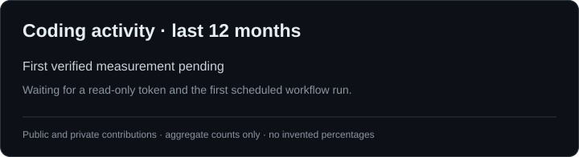

<h1 align="center">Haikal Thoriq Athaya</h1>

<strong>AI engineering · Backend systems · Data applications</strong>

I build retrieval systems for statistical documents, machine-learning applications, and backend tools for services I run myself. My recent work spans PDF processing, model evaluation, web apps, and self-hosted infrastructure.

  
  
  

---

## Selected work

### AI and data

- **RINGKAS 2.0** *(private, in development)*. A bilingual system for answering questions from official Statistics Indonesia (BPS) publications. The work covers PDF ingestion, source citations, retrieval, and evaluation. The related **RINGKAS Benchmarks** compare parsing and chunking methods under controlled tests.
- **[RAG Thesis](https://github.com/haikalthrq/RAG-Thesis)**. Compared three chunking methods for retrieving evidence from BPS documents, using Qwen3 embeddings, ChromaDB, and a 30-question evaluation set.
- **[CoReer](https://github.com/haikalthrq/CoReer)**. A CV analysis and job-matching web app with NLP, similarity matching, and a neural-network component. Built with Python, Flask, Node.js, and TensorFlow.
- **[PODES Batu 2024](https://github.com/haikalthrq/Website-PODES-Batu-2024)**. An interactive dashboard for village statistics, including maps, charts, and indicator filters. Built with React and Express. [Open the live dashboard](https://website-podes-batu-2024.vercel.app).
- **[TripAdvisor Sentiment Analysis](https://github.com/haikalthrq/tripadvisor-sentiment-cicd-dagshub-testing)**. A team MLOps project using TF-IDF and logistic regression for hotel-review classification, with Gradio, Docker, and CI/CD.

### Backend and infrastructure

- **[Monke-Bot](https://github.com/haikalthrq/Monke-Bot)**. A Discord control bot for self-hosted Valheim servers. It provides server status, health checks, and backups through restricted commands instead of giving Discord users shell access.
- **[System Monitoring Dashboard](https://github.com/haikalthrq/System-Monitoring-Dashboard)**. Live CPU, memory, disk, network, process, and Docker monitoring on Windows and Linux, using Python's standard library and Server-Sent Events.
- **[VPS-Agent](https://github.com/haikalthrq/VPS-Agent)**. Deployment scripts and configuration for running a Hermes agent on a Linux VPS with systemd, Discord access controls, and verification checks.
- **[Workload Monitoring](https://github.com/haikalthrq/workload-monitoring-converted)**. A full-stack conversion to React, Express, and MongoDB, including dashboards, authentication, and role-specific views.

### Game systems and developer tooling

- **Project Antares** *(private, planning and validation)*. Systems design for a Roblox game, including session management, shared state, and staged testing before gameplay implementation.
- **[Valheim Narrator](https://github.com/haikalthrq/Valheim-Narrator)**. A prototype for server-side game-event telemetry, with a BepInEx plugin foundation, a Python event-ingestion service, and SQLite persistence.
- **[Roblox AI Skills: Codex adapter](https://github.com/haikalthrq/roblox-ai-skills)** *(fork of [SyphoDev's project](https://github.com/SyphoDev-yt/roblox-ai-skills))*. Adds a Codex installation and integration path to the original Claude Code Roblox skills.
- **[Portable AI Skills](https://github.com/haikalthrq/ai-skill-portable)**. Scripts and documentation for backing up and restoring coding-agent skills and integrations across Codex, OpenCode, and Antigravity.

<strong>More repositories</strong>

#### Machine learning and analysis

- [MNIST & CIFAR-10 Image Classifier](https://github.com/haikalthrq/MNIST-CIFAR10-Image-Classifier) · PyTorch CNN experiments
- [Bike Sharing Analysis](https://github.com/haikalthrq/Bike-Sharing-Analysis) · exploratory analysis and Streamlit dashboard
- [PODES Batu: Streamlit Dashboard](https://github.com/haikalthrq/Dashboard-PODES-Batu-2024) · Python, Pandas, Plotly
- [MLOps CI/CD Practice](https://github.com/haikalthrq/mlops-ci-cd-practice) · GitHub Actions and Hugging Face Spaces
- [House Price Prediction](https://github.com/haikalthrq/house-price-prediction)

#### Apps and experiments

- [Cookie Tap Remaster](https://github.com/haikalthrq/Cookie-Tap-Remaster) · adapted from [risal098/cookie-tap](https://github.com/risal098/cookie-tap)
- [Minecraft Host](https://github.com/haikalthrq/Minecraft-Host)
- [revoU](https://github.com/haikalthrq/revoU)
- [web-test](https://github.com/haikalthrq/web-test)

## Tools I use

**Languages**

**ML, backend and storage**

**Web and infrastructure**

## Coding activity

This chart counts source files changed in my commits during the previous 12 months, including accessible public and private repositories. Notebook edits are tracked separately from Python scripts. Forks without original commits are excluded. [How this is measured](docs/CODING_ACTIVITY.md).

---

[Browse all public repositories](https://github.com/haikalthrq?tab=repositories)
